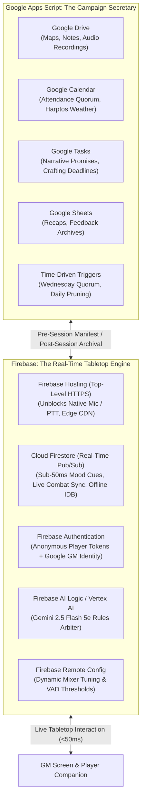
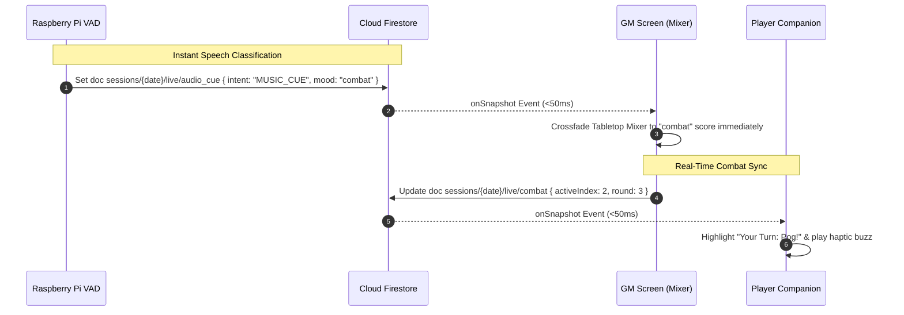
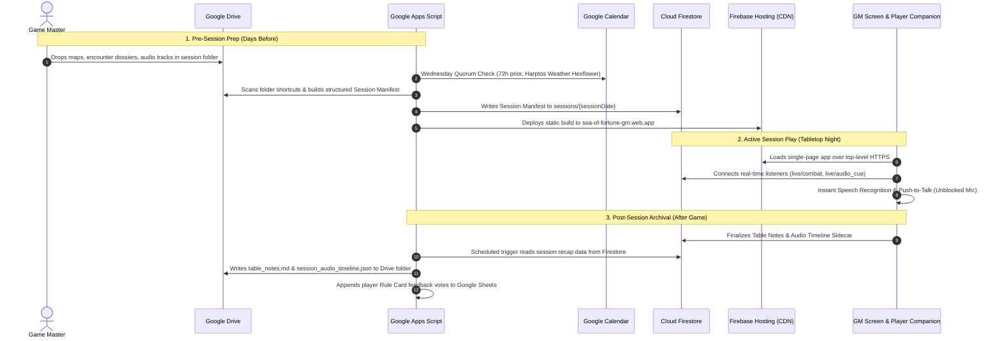
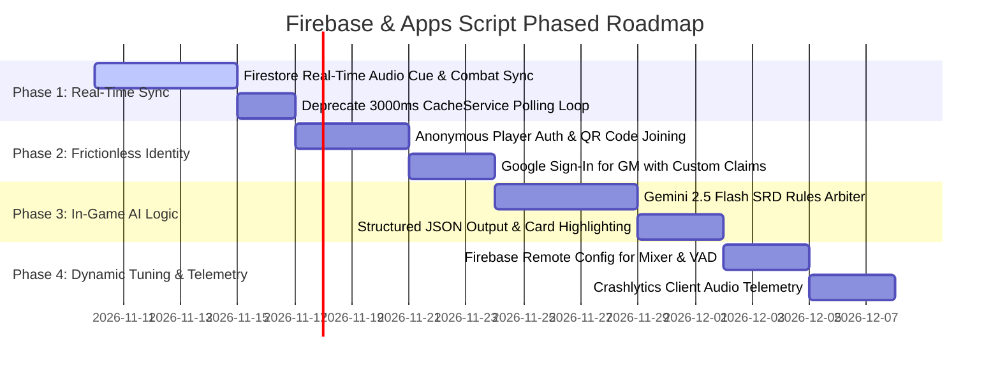

# Firebase & Google Apps Script Architectural Synergy

> Strategic architectural review and implementation roadmap combining Google Apps Script (Campaign Governance & Workspace Back-Office) with Firebase (Real-Time Tabletop Engine & Edge CDN).
>
> Validated with the `infigraph` AST analysis engine against repository code, ADRs (`0001`–`0010`), and domain requirements (`GLOSSARY.md`).

---

## 1. Executive Summary & The "Dual-Engine" Philosophy

The **Sea of Fortune GM Screen** has two distinct operational environments with fundamentally opposing performance profiles:



1. **The Campaign Back-Office (Google Apps Script):**
   - High-privilege, asynchronous, and deeply integrated with Google Workspace.
   - Naturally excels at file asset discovery in Google Drive, calendar attendance calculations in Google Calendar ([ADR-0010](adr/0010-workspace-governance-quorum-and-on-demand-promises.md)), tracking long-term character crafting deadlines in Google Tasks, and storing audit logs in Google Sheets.
   - **Constraint:** Synchronous HTTP polling of Apps Script (`CacheService` / `PropertiesService`) suffers from high latency (3000ms+ poll intervals), quota ceilings, and sandbox iframe restrictions ([ADR-0008](adr/0008-companion-isolation-and-os-dictation-fallback.md)).

2. **The Real-Time Tabletop Edge (Firebase):**
   - Low-latency, client-facing, and edge-distributed on top-level HTTPS.
   - Excels at top-level HTTPS media permissions (unblocking the **Push-to-Talk Rules Sniffer** without iframe walls), real-time document synchronization via WebSocket listeners (`onSnapshot`), frictionless identity (Anonymous Auth for players + OAuth for GM), and sub-second Gemini AI inference.
   - **Constraint:** Does not natively manage Google Drive folder structures, Google Calendar event RSVPs, or Google Tasks without external Workspace service accounts.

**The Solution:** Treat **Google Apps Script as the "Campaign Secretary"** and **Firebase as the "Tabletop Engine"**.

---

## 2. Codebase Review & `infigraph` AST Findings

Using `infigraph` to inspect symbol dependencies, cyclomatic complexity, call graphs, and architectural hubs reveals several critical architectural bottlenecks in the current implementation:

### 2.1. The Polling Tax & CacheService Hub

- **AST Finding (`infigraph search-code CacheService`):**
  - Live audio cues and companion rule queries are delivered via `doPost(e)` into Apps Script `CacheService.getScriptCache().put(..., 60)` ([ADR-0009](adr/0009-edge-pi-classifier-tiered-fallback.md)).
  - In `Index.html` (lines 3420–3480), `pollLatestAudioCue_()` runs an infinite client-side polling timer every `AUDIO_CUE_POLL_INTERVAL_MS = 3000ms`.
  - With 1 GM Screen and 5 Player Companion phones connected, the table generates **120 HTTP roundtrips/minute** against Apps Script Web App endpoints, consuming script execution quotas and introducing up to **3000ms of lag** before the **Tabletop Mixer** reacts to a spoken combat cue.

### 2.2. Rate Limiting & Storage Complexity

- **Complexity Finding (`infigraph complexity --threshold 10`):**
  - `setupClientHarness` has cyclomatic complexity **58**, and rate-limiting feedback functions in `Code.gs` require multi-tier in-memory cache locks and rolling-window calculation arrays to prevent sheet write exhaustion ([ADR-0008](adr/0008-companion-isolation-and-os-dictation-fallback.md)).
  - Without a dedicated database, Apps Script uses `LockService.getScriptLock()` to serialize Sheet row appends, creating queuing delays when multiple players vote on **Rule Cards** simultaneously.

### 2.3. Identity & Role Boundary

- **Security Finding (`infigraph search-code assertGmAccess_`):**
  - GM authentication relies on a single shared secret string (`SOF_GM_KEY`) passed in URL query parameters or session storage.
  - Player identity is stored in unverified `localStorage` (`sof_player_identity`), allowing any client to claim any player character (`Pog`, `Donald`, `Lyra`) without cryptographic attribution.

---

## 3. Top Architectural Opportunities for Firebase & Apps Script

### Opportunity 1: Real-Time Tabletop Pub/Sub via Cloud Firestore

**Target Subsystems:** **Tabletop Mixer**, **Audio Cue Dispatch**, **Combat Tracker**, **Rule Card Broadcast**

#### Problem

Currently, when the **Raspberry Pi VAD Chunker** classifies an audio intent (`MUSIC_CUE`, `RULE_QUERY`), it sends an HTTP POST to `doPost(e)` in `Code.gs`, which caches it for 60 seconds in `CacheService`. Client browsers poll every 3 seconds. When a GM advances initiative or modifies monster hit points in the **Combat Tracker**, companion phones receive no notification unless the page is manually reloaded.

#### Firebase Solution

Replace HTTP polling with **Cloud Firestore `onSnapshot` listeners**:



#### Benefits

- **Zero Polling Overhead:** Eliminates 7,200+ polling HTTP requests per session.
- **Sub-50ms Reaction Time:** Music score crossfades trigger the exact second combat is declared.
- **Offline Persistence:** Firestore's built-in IndexedDB persistence (`enableIndexedDbPersistence`) caches rules and tactical state locally, protecting against Wi-Fi drops at conventions or home tables.

---

### Opportunity 2: Frictionless Table Identity & Role-Based Access via Firebase Auth

**Target Subsystems:** **Player Companion**, **GM Screen Security**, **Rule Card Feedback**

#### Problem

Google Apps Script forces an all-or-nothing security model: either `access: "ANYONE"` (which blocks anonymous companion access behind a Google Account sign-in redirect), or `access: "ANYONE_ANONYMOUS"` (which strips all user identity, forcing reliance on plaintext `SOF_GM_KEY`).

#### Firebase Solution

Use **Firebase Authentication** with a hybrid Anonymous + Google Provider model:

1. **Players (Frictionless Anonymous Auth):**
   - Upon scanning a table QR code (`https://sea-of-fortune-gm.web.app?view=companion`), the phone calls `signInAnonymously(auth)`.
   - Generates a cryptographically signed UID stored in browser IndexedDB.
   - Selecting a character (`Pog`, `Donald`, `Vesper`) writes `{ claimedBy: uid }` to Firestore `sessions/{date}/characters/{charName}` with a security rule preventing two devices from claiming the same active character.
2. **Game Master (Google Sign-In with Custom Claims):**
   - GM clicks "GM Login" and authenticates via Google Popup (`signInWithPopup(auth, googleProvider)`).
   - Firebase Security Rules verify `request.auth.token.email == "wryenmeek@gmail.com"` (or custom claim `token.gm == true`).
   - Completely eliminates the need to remember, transmit, or rotate plaintext `SOF_GM_KEY` strings.

#### Firestore Security Rules Example

```javascript
rules_version = '2';
service cloud.firestore {
  match /databases/{database}/documents {
    // Session Manifest & Rules Glossary: Publicly readable by any authenticated player
    match /sessions/{sessionDate}/manifest/{docId} {
      allow read: if request.auth != null;
      allow write: if request.auth.token.email == "wryenmeek@gmail.com";
    }

    // Live Combat & Audio Cues: Readable by all, writable by GM or Edge Pi service account
    match /sessions/{sessionDate}/live/{docId} {
      allow read: if request.auth != null;
      allow write: if request.auth.token.email == "wryenmeek@gmail.com"
                  || request.auth.token.firebase.sign_in_provider == "custom";
    }

    // Player Rule Card Feedback: Rate limited & attributed to authentic player UID
    match /feedback/{feedbackId} {
      allow create: if request.auth != null
                    && request.resource.data.userId == request.auth.uid;
      allow update, delete: if false;
    }
  }
}
```

---

### Opportunity 3: Intelligent 5e Rules Arbitration via Firebase AI Logic (Vertex AI for Firebase)

**Target Subsystems:** **Push-to-Talk Rules Sniffer**, **Rules Glossary**, **Rule Card Dispatch**

#### Problem

Current rule queries in the **Player Companion** use `MiniSearch` client-side fuzzy keyword matching against 103 5e SRD cards ([ADR-0006](adr/0006-client-side-minisearch-tactical-engine.md)). When players ask complex natural language questions (e.g. _"Can I cast Misty Step if I cast Guiding Bolt as an action?"_ or _"Does an invisible creature provoke opportunity attacks?"_), keyword search matches either nothing or multiple irrelevant cards.

#### Firebase Solution

Leverage **Firebase AI Logic (Vertex AI for Firebase SDK)** with **Gemini 2.5 Flash**:

```javascript
import { getVertexAI, getGenerativeModel } from "firebase/vertexai";

const vertexAI = getVertexAI();
const rulesModel = getGenerativeModel(vertexAI, {
  model: "gemini-2.5-flash",
  generationConfig: {
    responseMimeType: "application/json",
    temperature: 0.1
  },
  systemInstruction:
    'You are the Sea of Fortune 5e Rules Arbiter. Analyze the player\'s voice query against 5e SRD rules.\nReturn a structured JSON with:\n{\n  "ruleCardId": "string (matching SRD card ID if applicable)",\n  "ruling": "concise 1-2 sentence ruling for the table",\n  "citation": "PHB/SRD reference",\n  "confidence": number\n}'
});
```

#### Benefits

- **Sub-Second Voice Resolution:** Gemini 2.5 Flash processes audio or transcripts in <800ms.
- **Prompt Caching:** Static 5e SRD rules text is cached at 75% discount, keeping API cost negligible.
- **Direct Rule Card Highlighting:** The model outputs the exact matching `ruleCardId`, prompting the **Player Companion** to immediately expand the canonical reference card with full text.

---

### Opportunity 4: Dynamic Tabletop Balancing via Firebase Remote Config

**Target Subsystems:** **Tabletop Mixer**, **Raspberry Pi VAD Classifier**, **Weather Hexflower**

#### Problem

Tuning audio crossfade times, auto-ducking volume multipliers, ambient track decay curves, or Raspberry Pi Silero VAD energy thresholds currently requires editing hardcoded constants in `Index.html` or `scripts/rpi_vad_chunker.py` and pushing new deployments.

#### Firebase Solution

Implement **Firebase Remote Config** for real-time parameter tuning:

| Parameter Key                  | Default | Description                                                |
| :----------------------------- | :------ | :--------------------------------------------------------- |
| `mixer_ducking_volume`         | `0.15`  | Background score volume during one-shot SFX play           |
| `mixer_crossfade_duration_s`   | `4.0`   | Crossfade duration between Mood Cues                       |
| `vad_silero_threshold`         | `0.50`  | Stage 1 Silero VAD confidence gate                         |
| `vad_tier1_timeout_ms`         | `1500`  | Stage 1 local Pi ONNX timeout before cloud failover        |
| `hexflower_weather_volatility` | `0.20`  | Probability of severe weather transitions per 4-hour watch |

The GM can tweak audio ducking or speech sensitivity from the Firebase Console on their phone during a live game session with zero code edits or service restarts.

---

### Opportunity 5: Edge Asset CDN & Resilient Audio Pre-Caching

**Target Subsystems:** **Tabletop Mixer**, **Session Asset Discovery**, **Floor Maps**

#### Problem

Audio session assets (15–50MB high-fidelity ambient loops) and 4K battlemaps are served via Google Drive `lh3.googleusercontent.com/d/{fileId}` or Drive API v3 `alt=media` bearer fetches ([ADR-0007](adr/0007-drive-v3-bearer-fetch-indexeddb-audio-cache.md)). Google Drive enforces strict per-user download rate limits and requires valid OAuth bearer tokens that expire after 60 minutes.

#### Firebase Solution

- **Firebase Hosting Edge CDN:** Already deployed at `https://sea-of-fortune-gm.web.app` on Google's global SSD edge network with HTTP/3.
- **Session Asset Optimization Pipeline:**
  1. Apps Script scans the Google Drive session folder before the game.
  2. A lightweight background job exports and hashes maps into modern WebP slices and audio into optimized `.opus` or `.m4a` streams.
  3. These are served via Firebase Hosting or Cloud Storage with immutable cache headers (`Cache-Control: public, max-age=31536000, immutable`), guaranteeing instantaneous zero-quota downloads.

---

### Opportunity 6: Operational Telemetry & Crash Monitoring via Firebase Crashlytics

**Target Subsystems:** **Web Audio Engine**, **Push-to-Talk Rules Sniffer**, **Raspberry Pi VAD Chunker**

#### Problem

If a player's phone fails to decode a Web Audio buffer, drops IndexedDB transactions, or encounters a Speech Recognition microphone error, the error is logged only to client DevTools console—completely invisible to the GM.

#### Firebase Solution

Integrate Firebase Web Crashlytics / Performance Monitoring:

- Automatically captures client-side `AudioContext` suspension states, microphone permission denials, and IndexedDB quota errors across mobile companion devices.
- Dispatches alert notifications to the GM Screen status bar if an edge service (e.g. Raspberry Pi offline or Pi microphone disconnected) fails during play.

---

## 4. The Unified Data Contract: Apps Script ↔ Firebase



---

## 5. Architectural Decision Record Proposal (ADR-0011)

### Status: Proposed

### Context

[ADR-0001](adr/0001-google-apps-script-architecture.md) established the GM Screen as a Google Apps Script Web App. [ADR-0008](adr/0008-companion-isolation-and-os-dictation-fallback.md) identified the `#sandboxFrame` microphone permission wall. We resolved the top-level origin requirement by deploying the frontend to Firebase Hosting under Google Cloud project `robotic-casing-443602-g2` ([`sea-of-fortune-gm.web.app`](https://sea-of-fortune-gm.web.app)). We now need an active standard for data persistence and real-time tabletop state.

### Decision

Adopt a **Dual-Engine Architecture**:

1. **Google Apps Script** remains the single source of truth for **Workspace Campaign Governance**: Google Calendar attendance quorum, Google Tasks narrative promises, Google Drive session asset folders, and Google Sheets feedback archiving.
2. **Cloud Firestore & Firebase Hosting** serve as the **Live Tabletop Edge Engine**: real-time mood cue pub/sub, live combat tracker synchronization, anonymous player authentication, and top-level microphone access.
3. Replace 3000ms HTTP polling of `CacheService` with Firestore `onSnapshot` real-time listeners.

### Consequences

- **Positive:** Sub-50ms mood cue reaction time; zero HTTP polling quota consumption; true multi-device combat tracker sync; unblocked mobile microphone voice sniffer; cryptographic player authentication.
- **Negative:** Requires maintaining Firebase Security Rules alongside Apps Script `assertGmAccess_` checks; local development harnesses must mock or emulate Firestore alongside Apps Script mocks.

---

## 6. Phased Implementation Roadmap



### Phase 1: Real-Time Tabletop Sync (Cloud Firestore)

1. Initialize Cloud Firestore on project `robotic-casing-443602-g2`.
2. Connect `onSnapshot` listener in `Index.html` to collection `sessions/{date}/live`.
3. Update `scripts/rpi_vad_chunker.py` and `doPost(e)` to emit cues directly to Firestore.
4. Eliminate `pollLatestAudioCue_()` timer in `Index.html`.

### Phase 2: Frictionless Identity (Firebase Auth & Security Rules)

1. Enable Firebase Anonymous Authentication and Google Provider.
2. Replace `localStorage` player tag with cryptographically verifiable character claim.
3. Deploy declarative Firestore Security Rules protecting GM encounter dossiers.

### Phase 3: Conversational Rules Arbiter (Firebase AI Logic)

1. Integrate Vertex AI for Firebase SDK in `Index.html`.
2. Bind Push-to-Talk dictation output to Gemini 2.5 Flash with 5e SRD system prompt.
3. Return structured JSON with automatic rule card modal expansion.

### Phase 4: Dynamic Table Tuning (Remote Config & Telemetry)

1. Integrate Firebase Remote Config for mixer ducking volumes, crossfades, and VAD thresholds.
2. Add Crashlytics Web SDK to monitor client audio buffer health across devices.
