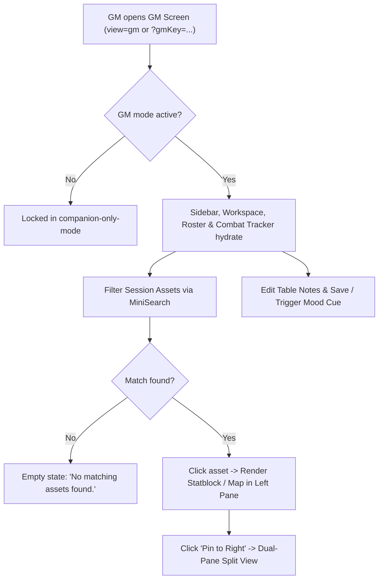
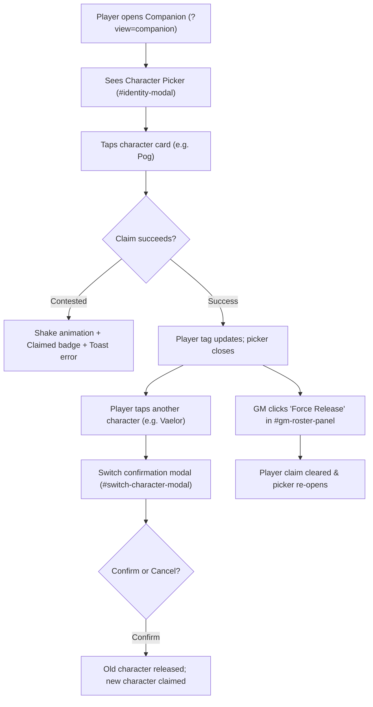
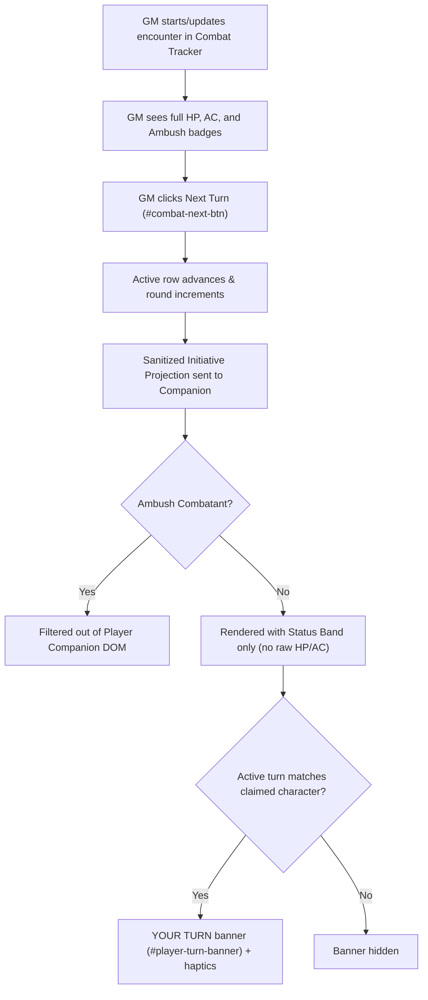
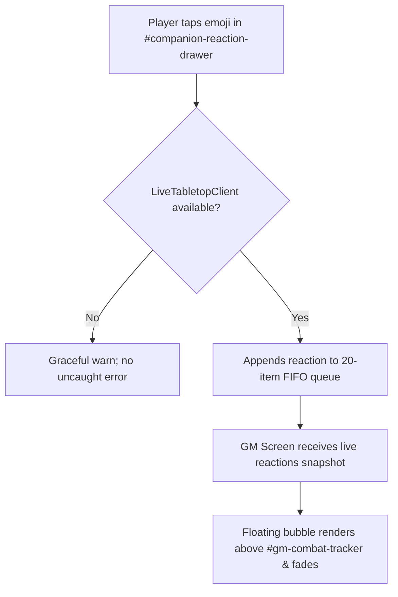
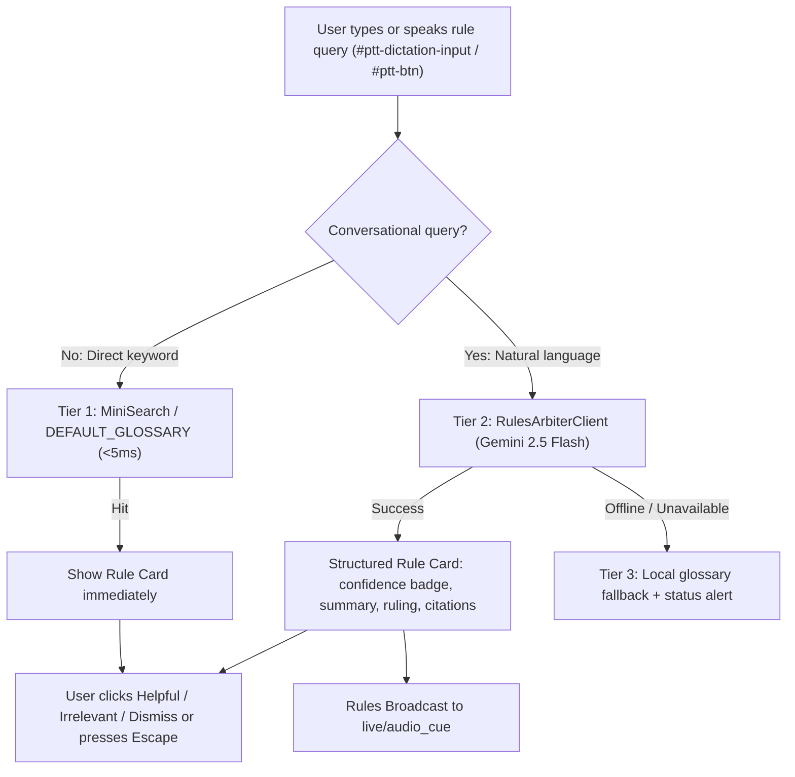
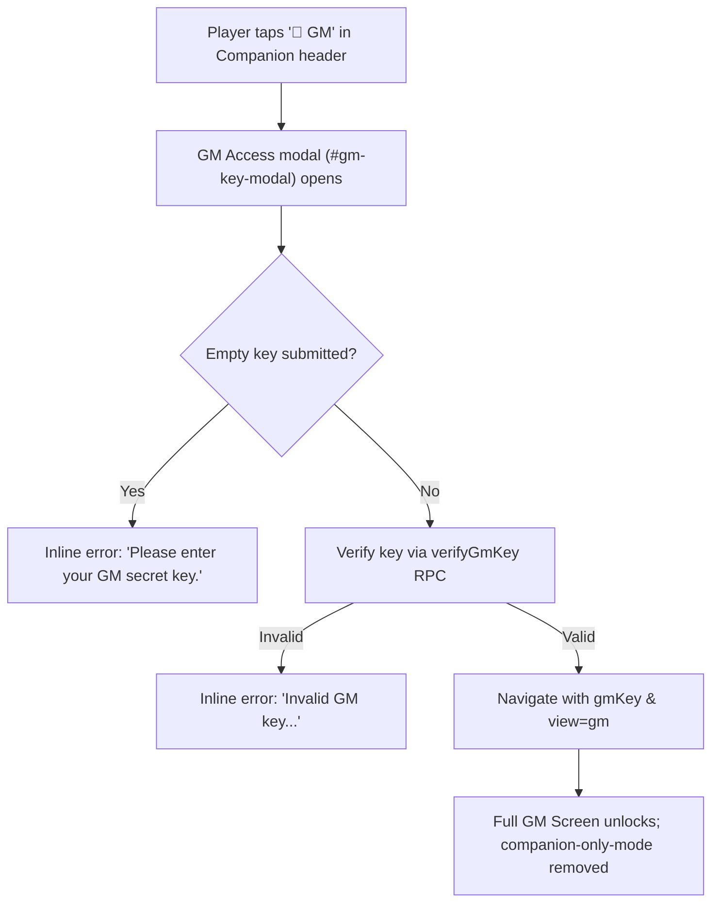

# Dogfood Report — test/ux-dogfood-audit

> Diff-scoped browser QA of `test/ux-dogfood-audit` (Phase 2 & Phase 3 UX flows vs pre-Phase-2 baseline `6f5ed62`). Generated by `ce-dogfood` on 2026-11-18.

## Diff Summary

- **Dual-Engine Real-Time Tabletop Foundation (`src/live_tabletop_client.ts`, `firestore.rules`, `Index.html`, `public/index.html`):** Added Cloud Firestore Modular SDK v11 real-time pub/sub for `live/audio_cue` (sub-50ms audio cues + fallback polling suppression), partitioned GM (`combat_gm`) vs public player (`combat`) initiative tracking with Status Bands and Ambush Combatant filtering, and Firebase Hosting target (`public/index.html`) with Apps Script RPC transport bridge.
- **Anonymous Onboarding, Character Roster Claiming & GM Force Release (`Index.html`, `public/index.html`, `src/live_tabletop_client.ts`):** Added character picker cards (`Pog`, `Vaelor`, `Orca`, `Fade`, `Guest`) with transactional claiming, contested claim shake/toast feedback (`handleClaimRaceLoss_`), switch confirmation modal (`#switch-character-modal`), and GM sidebar Party Roster panel (`#gm-roster-panel`) with `Force Release`.
- **Ambient Turn Haptics & Ephemeral 5-Emoji Table Reactions (`Index.html`, `public/index.html`):** Added `#player-turn-banner` with `navigator.vibrate` haptics when the player's claimed character is active in initiative, a sticky 5-emoji `#companion-reaction-drawer` (`⚔️`, `🛡️`, `🎲`, `🍻`, `💀`) backed by a 20-item FIFO queue, and floating bubbles above `#gm-combat-tracker`.
- **3-Tier Rules Lookup Ladder & Conversational Rules Arbiter (`src/rules_arbiter_client.ts`, `Index.html`, `public/index.html`):** Added `RulesArbiterClient` (Firebase AI Logic / Gemini 2.5 Flash) for conversational queries (`isConversationalQuery_`), keeping Tier 1 `MiniSearch` fast-path for direct keywords and Tier 3 local glossary fallback offline, plus structured `#rule-card` rendering with confidence badges (`exact`, `interpretation`, `unsupported`), `#card-ruling`, `.citation-pill` chips, hover-pausable 30s decay, Rules Broadcast (`live/audio_cue`), and Firestore/Apps Script Rule Feedback.
- **In-App GM Login & View Mode Controls (`Index.html`, `public/index.html`):** Added `🔑 GM` login modal (`#gm-key-modal`) and `🔄` player character switcher in Player Companion, plus `📱 Companion` link in GM Screen.

## Personas

Inferred from `GLOSSARY.md` and `docs/FIREBASE_APPS_SCRIPT_SYNERGY.md`:

- **Game Master (Desktop GM — 1440x900)** — Runs the live tabletop session at a laptop: needs instant access to Session Assets, Pinned Pane split view, Table Notes, Tabletop Mixer mood cues, full unredacted Combat Tracker with Ambush Combatants, Party Roster claim management (`Force Release`), and unobstructed Rule Cards without stale UI chrome or mode lock-in.
- **Tabletop Player (Mobile Companion — 390x844)** — Joins from a phone on the table via `?view=companion`: needs fast 1-tap character claiming (and clear feedback on contested claims or switching), sanitized Initiative Order with Status Bands (no GM HP/ambush leaks), unmistakable active-turn alerts, tactile Table Reactions, and fast voice/typed 5e rules lookups with clear rulings and citations.

## Flows Tested

### Flow 1: GM Screen Workspace, Search, Pinned Split View & Table Notes

### Flow 2: Player Companion Character Roster Claiming, Contested Claim & GM Force Release

### Flow 3: Dual-Partition Combat Tracker, Ambush Redaction & Turn Alert Banner

### Flow 4: Ephemeral 5-Emoji Table Reactions & GM Floating Bubbles

### Flow 5: 3-Tier Rules Lookup Ladder, Structured Rule Card & Tabletop Broadcast

### Flow 6: Companion ↔ GM Login Modal & View Mode Isolation

## Test Matrix & Results

| #   | Flow   | Journey / Scenario                                                                                | Status                   | Issue                                                                                                                                               | Fix                                                                                                                                          | Commit    |
| --- | ------ | ------------------------------------------------------------------------------------------------- | ------------------------ | --------------------------------------------------------------------------------------------------------------------------------------------------- | -------------------------------------------------------------------------------------------------------------------------------------------- | --------- |
| 1   | Flow 1 | Desktop GM boot & view mode (`?view=gm&gmKey=...`) + HTTP UTF-8 charset + sidebar flex sizing     | Fixed                    | `public/index.html` locked in `companion-only-mode`, missing `<meta charset="utf-8" />` caused emoji mojibake, and flex layout crushed `#file-list` | Remove `companion-only-mode` in GM mode, add `<meta charset="utf-8" />`, rebalance sidebar CSS                                               | `18825d9` |
| 2   | Flow 1 | GM Screen search filter, statblock rendering & Pinned Pane split                                  | Pass                     | -                                                                                                                                                   | -                                                                                                                                            | -         |
| 3   | Flow 1 | GM Party Roster hydration (`#gm-roster-list`) & Force Release                                     | Fixed                    | `#gm-roster-list` stayed stuck on `"Loading roster..."` without live `LiveTabletopClient`                                                           | Hydrate default 5-character roster (`Pog`, `Vaelor`, `Orca`, `Fade`, `Guest`) as `Unclaimed` fallback                                        | `18825d9` |
| 4   | Flow 2 | Companion character picker, selection, contested claim & switch modal                             | Pass                     | -                                                                                                                                                   | -                                                                                                                                            | -         |
| 5   | Flow 3 | GM Combat Tracker turn advancement, Ambush Combatant badges & floating reaction bubble clipping   | Fixed                    | `Vis` badges wrapped onto 2 lines and `#gm-combat-tracker` `overflow-y: auto` clipped floating reaction bubbles                                     | Set `overflow: visible` on `#gm-combat-tracker`, `white-space: nowrap` on badges, `58px` `Vis` column                                        | `18825d9` |
| 6   | Flow 3 | Companion sanitized Initiative Projection, Status Bands & Turn Alert Banner                       | Pass                     | -                                                                                                                                                   | -                                                                                                                                            | -         |
| 7   | Flow 4 | Companion 5-emoji Table Reactions drawer & GM floating bubbles                                    | Pass                     | -                                                                                                                                                   | -                                                                                                                                            | -         |
| 8   | Flow 5 | Tier 1 local Rules Lookup Ladder (`Grappling`, `Misty Step`) via `#ptt-dictation-input`           | Pass                     | -                                                                                                                                                   | -                                                                                                                                            | -         |
| 9   | Flow 5 | Tier 2 Rules Arbiter structured Rule Card (confidence badge, ruling, citations, feedback, Escape) | Pass                     | -                                                                                                                                                   | -                                                                                                                                            | -         |
| 10  | Flow 5 | Live Tier 2 / Firestore browser bundle in `Index.html` & `public/index.html`                      | Blocked (human decision) | `window.LiveTabletopClient` and `window.RulesArbiterClient` are `undefined` in static HTML (TypeScript ESM modules not bundled)                     | Escalated to **Decisions for a Human**                                                                                                       | -         |
| 11  | Flow 6 | Companion `🔑 GM` login modal validation, close, and transition to GM mode                        | Fixed                    | `navigateWithGmKey_` deleted `view` param and `public/index.html` defaulted omitted `view` to `"companion"`                                         | Propagate `view=gm` in `navigateWithGmKey_` and default `rawViewModeTemplate` to `"gm"` when `gmKey` is present (`scripts/export-static.js`) | `18825d9` |

## What Was Fixed

### GM View Mode Lock-In & `view=gm` Login Redirect — `18825d9`

- **Symptom:** Opening `public/index.html` at `?view=gm&gmKey=test-gm-key` or `?gmKey=test-gm-key` kept `companion-only-mode` active on `<body>`, rendering `#player-hud` (`width: 100%`) beside `#sidebar` and pushing `#workspace` off-screen.
- **Root cause:** `public/index.html` sets `<body class="companion-only-mode">`, `initCompanionState_()` never removed `companion-only-mode` when `isCompanionMode_()` was `false`, `isCompanionMode_()` did not check `view=gm`, `navigateWithGmKey_()` deleted the `view` param, and `scripts/export-static.js` defaulted omitted `view` to `"companion"` even when `gmKey` was present.
- **Fix:** Updated `isCompanionMode_()`, `initCompanionState_()`, and `navigateWithGmKey_()` in `Index.html` and `public/index.html`, and updated `scripts/export-static.js` to default `rawViewModeTemplate` to `"gm"` when `gmKey` is set.
- **Regression test:** Added `"clears preset companion-only-mode when booting in GM mode and propagates view=gm on GM login redirect"` in `test/mobile_ux.test.ts` (fails before fix, passes after) and re-verified in `agent-browser` at `1440x900`.

### Missing UTF-8 Charset Declaration Causing Emoji Mojibake Over HTTP — `18825d9`

- **Symptom:** Opening `public/index.html` over HTTP (`python3 -m http.server`) rendered all UI emojis (`⚔️`, `🎙️`, `🔑`, `✕`, `👍`) as Windows-1252 mojibake (`âš”ï¸`, `🎙ï¸`).
- **Root cause:** Neither `Index.html` nor `public/index.html` declared `<meta charset="utf-8" />` in `<head>`, so HTTP responses without a `charset=utf-8` header fell back to legacy single-byte decoding.
- **Fix:** Added `<meta charset="utf-8" />` as the first element in `<head>` in `Index.html` and regenerated `public/index.html` via `scripts/export-static.js`.
- **Regression test:** Pure HTML encoding header fix verified directly in `agent-browser` over `python3 -m http.server` (screenshots and `snapshot -i` output confirm clean UTF-8 emoji rendering); no separate unit assertion was meaningful since `happy-dom` and Playwright `setContent` always parse JS strings as UTF-16/UTF-8.

### Offline / Unbundled GM Party Roster Stuck on Loading — `18825d9`

- **Symptom:** `#gm-roster-list` in the GM Screen sidebar displayed `"Loading roster..."` indefinitely whenever no live `LiveTabletopClient` instance was attached.
- **Root cause:** `initGmRoster_()` returned without rendering anything when `getOrCreateLiveTabletopClient_()` returned `null`.
- **Fix:** Added a default 5-character fallback (`Pog`, `Vaelor`, `Orca`, `Fade`, `Guest` with `claimedBy: null`) passed to `updateGmRosterDom_()` in `Index.html` and `public/index.html`.
- **Regression test:** Added `"hydrates #gm-roster-list with default party characters when LiveTabletopClient is unavailable"` in `test/client.test.ts` (fails before fix, passes after) and verified in `agent-browser`.

### GM Sidebar Proportions, Badge Wrapping & Reaction Bubble Clipping — `18825d9`

- **Symptom:** On `1440x900`, `#scratchpad-container` (`40%`) and two equal `flex: 1` `.sidebar-section` containers squeezed `#file-list` and `#gm-roster-panel`; `👁️ Public` / `👁️ Hidden` badges wrapped onto two lines; and `#gm-combat-tracker` (`overflow-y: auto`) clipped `.floating-reaction-bubble` rising above the tracker header.
- **Root cause:** `#gm-combat-tracker` inherited `overflow-y: auto` from `.sidebar-section` despite `.combat-table-wrapper` already managing vertical table scrolling, and `.ambush-badge` / `.visible-badge` lacked `white-space: nowrap` inside a `44px` column.
- **Fix:** Added `min-height: 90px` to `#file-list`, reduced `#scratchpad-container` height to `25%`, set `#gm-combat-tracker` to `flex: 0 0 auto; max-height: 210px; overflow: visible;`, added `white-space: nowrap` to `.ambush-badge` and `.visible-badge`, and widened the `Vis` column header to `58px` in `Index.html` and `public/index.html`.
- **Regression test:** Added Playwright UX + visual snapshot test `"7. Desktop GM: Combat Tracker, Ambush Badges, Party Roster & Floating Reactions (1440x900)"` in `test/visual/component_snapshot.spec.ts` and visually inspected the generated PNG (`desktop-gm-combat-roster-reactions.png`).

### Expanded Playwright UX Regression Coverage & Tightened Pixel Tolerance — `162ba76`

- **Symptom:** Existing Playwright suite only covered 10 pre-Phase-2 visual states with a permissive `maxDiffPixelRatio: 0.05` (64,800px at `1440x900`), which masked GM sidebar regressions (`Mobile Companion Baseline Idle` already failed with 16% diff), and `renderTemplateHtml("companion")` failed to substitute `<?= typeof viewMode ... ?>`, causing `window.INITIAL_VIEW_MODE` to evaluate to `"gm"`.
- **Root cause:** `playwright.config.ts` allowed 5% pixel drift, `Desktop GM Baseline Idle` did not wait for `#file-list` / `#gm-roster-list` hydration, `renderTemplateHtml` left template expressions unreplaced, and Phase 2/3 flows had zero Playwright coverage.
- **Fix:** Tightened `maxDiffPixelRatio` to `0.01` in `playwright.config.ts`, updated `renderTemplateHtml` and `Desktop GM Baseline Idle` wait selectors in `test/visual/component_snapshot.spec.ts`, added UX & visual tests 7–11 covering GM Combat Tracker + Party Roster + Reactions, Companion Sanitized Initiative + Status Bands + Turn Alert, Companion Character Switch Modal, Structured Rules Arbiter Card, and In-App GM Login Modal, and regenerated golden snapshots.
- **Regression test:** `npm run test:visual -- --reporter=list` passes 15/15 tests at `maxDiffPixelRatio: 0.01`.

## Paper Cuts (by persona)

- **Tabletop Player** — `.toast-container` (`bottom: 24px`, `z-index: 9999`) briefly overlaps `#rule-card` action buttons (`Helpful` / `Irrelevant` / `Dismiss`) when a contested-claim toast fires while a Rule Card is open on `390x844` — minor — deferred (positioning toasts at top of viewport when `#rule-card.visible` is open is a clean follow-up).
- **Tabletop Player** — Clicking `🎙️ Tap to Ask Rule` in browsers without microphone access or outside an iframe reports `"Microphone access blocked by browser iframe security..."` even when running standalone on `localhost` — minor — deferred (copy accuracy).
- **Game Master** — `public/index.html` defaults to `2026-10-31` and attempts cross-origin Apps Script RPC fetches to the hardcoded `DEFAULT_WEB_APP` URL when opened locally without network/Drive credentials — minor — deferred (expected standalone fallback behavior).

## Console Errors

- `[warning] RPC fetch error: TypeError: Failed to fetch` observed once on initial boot in `agent-browser` against `http://localhost:3099/?view=companion` because the local static test server cannot reach the external `script.google.com` Apps Script endpoint offline; handled gracefully with zero uncaught page errors (`agent-browser errors` returned empty across all scenarios).

## Human Verifications

- **Live Cloud Rules Arbiter (Gemini 2.5 Flash) & Firestore Emulator/Production Sync:** Cannot be driven headlessly without a browser bundle exposing `window.LiveTabletopClient` / `window.RulesArbiterClient` and live Firebase/Gemini API credentials; verified via unit/integration tests (`test/client.test.ts`, `test/mobile_ux.test.ts`, `test/rules_arbiter.test.ts`, `test/firestore_rules.test.ts`).
- **Google Apps Script OAuth & `clasp` Web App HTML Service:** Live `google.script.run` Drive manifest, Table Notes, and `verifyGmKey` round-trip require authenticated Google Drive execution in Apps Script.

## Decisions for a Human

### Bundle `src/live_tabletop_client.ts` and `src/rules_arbiter_client.ts` into `Index.html` and `public/index.html`

- **What's broken:** Scenario 10 (`Live Tier 2 / Firestore browser bundle`) is `Blocked (human decision)`. Although `src/live_tabletop_client.ts` and `src/rules_arbiter_client.ts` are fully implemented and unit-tested via `test/helpers/client-harness.ts`, neither `Index.html` nor `public/index.html` loads a browser bundle that assigns `window.LiveTabletopClient` or `window.RulesArbiterClient` (and Firebase config). In `agent-browser`, both globals evaluate to `"undefined"`, so conversational Tier 2 Rules Arbiter queries fall back to Tier 3 local glossary search and real-time Firestore listeners (`audio_cue`, `combat`, `roster`, `reactions`) remain inactive in the live browser.
- **Why escalated:** Choosing and introducing a browser bundling pipeline (`esbuild`/Vite/Rollup) and Firebase project config injection affects Apps Script `HtmlService` size/script-inlining constraints (`clasp push` single-file `Index.html` vs external Firebase Hosting assets), `package.json` dependencies, `knip.json`, and CI workflows.
- **Options:**
  - **Option A (esbuild IIFE inline bundle):** Add a build script (`esbuild`) compiling `src/live_tabletop_client.ts` and `src/rules_arbiter_client.ts` into a browser IIFE attaching `window.LiveTabletopClient` / `window.RulesArbiterClient` (injected into `Index.html` or `public/index.html` via `scripts/export-static.js`). Pros: works inside Apps Script `HtmlService` AND Firebase Hosting with zero external module path issues; Cons: increases single-file `Index.html` byte size and adds a build artifact/step before `clasp push`.
  - **Option B (ESM bundle + Firebase Hosting assets):** Emit ES module bundles under `public/assets/` for Firebase Hosting and keep CDN `<script type="module">` imports for Apps Script. Pros: keeps `Index.html` small and cacheable; Cons: diverges `Index.html` and `public/index.html` asset loading and requires CORS/CSP coordination inside Apps Script iframe sandboxes.
- **Recommendation:** Adopt **Option A** with `esbuild --bundle --format=iife` driven by `scripts/export-static.js` (or an explicit `npm run build` step gated by `npm run check`) so Apps Script and Firebase Hosting share identical runtime globals.

## Learnings

- **Full-viewport `maxDiffPixelRatio: 0.05` masks major UI regressions:** At `1440x900` (`1,296,000` px), 5% tolerates `64,800` changed pixels—large enough to hide entire sidebar sections being replaced or omitted. Tightening to `0.01` and asserting specific DOM hydration selectors (`#file-list .file-item`, `#gm-roster-list .gm-roster-item`, `#player-hud` visibility) prevents silent false greens.
- **Playwright `page.setContent()` masks HTTP charset bugs:** `page.setContent(html)` decodes JS UTF-16 strings directly, whereas real browsers loading HTML over HTTP servers without `; charset=utf-8` decode UTF-8 emojis as mojibake unless `<meta charset="utf-8" />` is explicitly present in `<head>`.
- **Unit harnesses injecting `window.*` globals mask missing production browser bundles:** `test/helpers/client-harness.ts` automatically mounts `MockLiveTabletopClient` and `MockRulesArbiterClient` onto `window`, allowing all 218 unit tests to pass even though `Index.html` and `public/index.html` do not bundle `src/live_tabletop_client.ts` or `src/rules_arbiter_client.ts` yet.
- **Stale `.infigraph/reviews/issue_*_audit.json` ledgers block cross-session commits:** Leftover `VERIFIED_COMPLETE` ledgers from PR #50 (`issue_46..49_audit.json`) blocked commits on `test/ux-dogfood-audit` until cleared; filed upstream bug report in `wryenmeek/antigravity-guard` (`https://github.com/wryenmeek/antigravity-guard/issues/11`).

## Final Status

- **Readiness Verdict:** **Ready for targeted human review (1 escalated architectural decision).** All verified local UX flows, unit regression tests, and Playwright UX/visual tests pass and are committed on `test/ux-dogfood-audit` (`18825d9`, `162ba76`). Scenario 10 (`Blocked (human decision)`) awaits a decision on bundling `LiveTabletopClient` and `RulesArbiterClient` into `Index.html` / `public/index.html`.
- **Automated Suite Results (Phase 5 verification):**
  - `npm run check`: **PASS** (0 errors across `tsc`, `eslint`, `stylelint`, `markdownlint-cli2`, `prettier`, `validate_session_artifacts.py`, `vitest` **218/218 tests across 7 files**, and `knip`).
  - `npm run test:visual -- --reporter=list`: **PASS** (**15/15 Playwright UX & visual regression tests** at `maxDiffPixelRatio: 0.01`).
