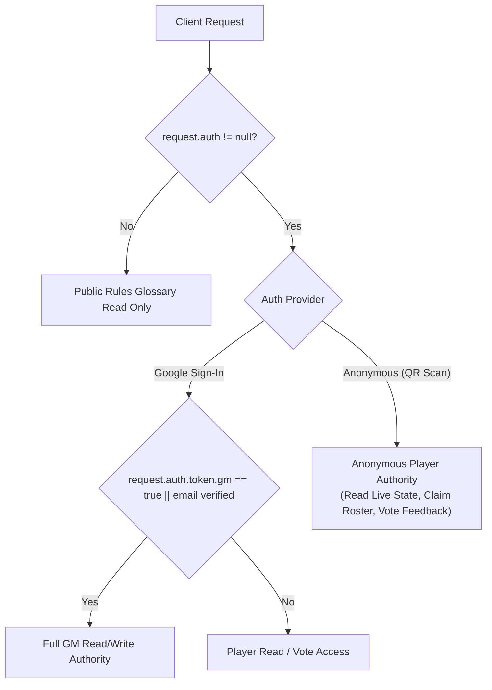
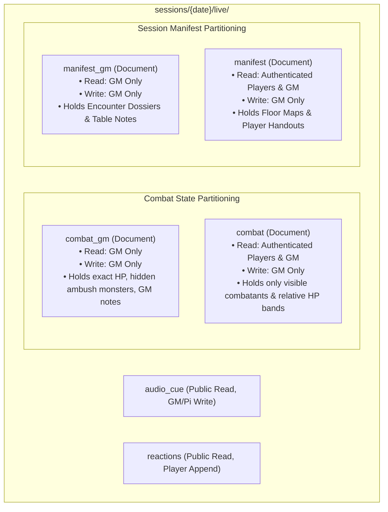
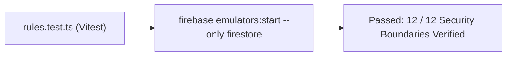

# Research Report: Cloud Firestore Security Rules & Role-Based Access Boundary

**Ticket:** Issue #30 (`[Wayfinder 13] Cloud Firestore Security Rules & Role-Based Access Boundary`)
**Map:** Issue #28 (`[Wayfinder Map] Dual-Engine Real-Time Tabletop & Frictionless Companion`)
**Date:** 2026-11-17
**Status:** Resolved

---

## Question

What declarative Firestore Security Rules (`firestore.rules`) and authentication claims are required to strictly partition GM-only administrative operations (writing to `sessions/{date}/manifest`, `audio_cue`, and `combat`) from player operations (reading live state, logging rule feedback, and claiming characters via Anonymous Auth), ensuring that curious players inspecting DevTools on personal smartphones cannot manipulate combat order or uncover unrevealed encounter assets?

Specifically resolve:

1. **Identity & Role Verification**: Comparing Google Sign-In with Custom Claims (`request.auth.token.gm == true`) versus verified email matching (`request.auth.token.email_verified == true`), and defining the anonymous player credential model (`request.auth.token.firebase.sign_in_provider == 'anonymous'`).
2. **Raspberry Pi Edge Writer Identity**: Documenting the security impact of the Raspberry Pi Admin SDK service account (which bypasses security rules) and establishing necessary IAM and host-level guardrails.
3. **The Field-Level Leak Problem (Document-Level Access Boundary)**: Firestore rules cannot filter fields within a document upon read. If unrevealed encounter assets or hidden ambush combatants (`isPlayerVisible: false`) are stored in player-readable documents, they leak via DevTools. Formulating an architectural document partition to solve this.
4. **Character Roster Claiming Concurrency**: Rules governing `sessions/{date}/roster/{characterId}` to ensure players can claim unclaimed characters, update their own claimed character, release claims, and prevent claim theft or tampering.
5. **Complete Draft `firestore.rules`**: Providing a production-grade rules file with strict schema validation, type checking, string length boundaries, and `hasOnly` field whitelisting.
6. **Automated Verification Strategy**: Outlining a unit testing suite using `@firebase/rules-unit-testing` and the Firebase Local Emulator Suite.

---

## Primary-Source Findings

### 1. Identity Verification & Role-Based Access Control

In Cloud Firestore, all declarative security decisions evaluate against the incoming `request.auth` context object ([Firebase Documentation: Rules Request Context](https://firebase.google.com/docs/firestore/security/rules-conditions#request)).



#### 1.1. Game Master Identity: Custom Claims vs. Email Matching

| Mechanism                                 | Implementation in Rules                                                                          | Pros                                                                                                                             | Cons / Vulnerabilities                                                                                               |
| :---------------------------------------- | :----------------------------------------------------------------------------------------------- | :------------------------------------------------------------------------------------------------------------------------------- | :------------------------------------------------------------------------------------------------------------------- |
| **Option A: Custom Claims (Recommended)** | `request.auth.token.gm == true`                                                                  | Cryptographically signed in the JWT; role-based; decoupled from individual email addresses; easily supports co-DMs or guest GMs. | Requires an initial script execution via Firebase Admin SDK (`setCustomUserClaims(uid, { gm: true })`) to provision. |
| **Option B: Verified Email Whitelist**    | `request.auth.token.email == "wryenmeek@gmail.com" && request.auth.token.email_verified == true` | Zero provisioning required; GM logs in with Google and is immediately recognized.                                                | Hardcodes email address into repo version control; fragile if GM changes accounts or adds an assistant GM.           |

**Recommended Pattern: Custom Claims with Bootstrap Email Fallback**
The rules evaluate a helper `isGm()` that checks for the custom claim `token.gm == true`, while falling back to a verified GM email whitelist:

```javascript
function isGm() {
  return (
    request.auth != null &&
    (request.auth.token.gm == true ||
      (request.auth.token.email == "wryenmeek@gmail.com" &&
        request.auth.token.email_verified == true))
  );
}
```

#### 1.2. Anonymous Player Companion Identity

Players scanning the physical tabletop QR code trigger `signInAnonymously(auth)`. This mints a valid Firebase Auth credential with:

- A unique, immutable user ID (`request.auth.uid`),
- `request.auth.token.firebase.sign_in_provider == 'anonymous'`,
- `request.auth.token.email == null`.

This UID is persisted in the smartphone's local `IndexedDB` by the Firebase SDK, giving each player a stable, tamper-proof device identity across page refreshes for the duration of the session without requiring OAuth consent screens or email passwords.

---

### 2. Raspberry Pi Edge Writer Authority & IAM Mitigation

A foundational concept of Firebase security architecture is that **the Firebase Admin SDK (used by Python scripts and backend daemons) completely bypasses Cloud Firestore Security Rules** ([Firebase Documentation: Admin SDK Authentication](https://firebase.google.com/docs/admin/setup)).

When `scripts/rpi_vad_chunker.py` connects to Firestore via a Google Cloud Service Account JSON key:

- It writes with full administrative bypass (`Security Rules: Ignored`).
- It can overwrite any document in any collection across the entire project.

#### Containment & Principle of Least Privilege

To prevent a compromised or physically accessible Raspberry Pi from becoming a vulnerability:

1. **Dedicated Service Account**: Do NOT use the default Firebase Admin / App Engine service account. Provision a dedicated service account: `sof-edge-classifier@robotic-casing-443602-g2.iam.gserviceaccount.com`.
2. **Granular IAM Role**: Grant only `roles/datastore.user` (Cloud Datastore User).
3. **Host-Level File Protection**:
   - The service account credentials file must be stored on the Pi at `/etc/sof/firebase-credentials.json`.
   - File permissions locked down to `chmod 600` owned by `root:sof-daemon`.
4. **Audit Logging**: Cloud Audit Logs track all writes by the edge service account identity, providing a tamper-proof write history.

---

### 3. The Field-Level Leak Problem & Architectural Partitioning

A critical limitation of Cloud Firestore Security Rules: **Rules are enforced at the document boundary, not the field boundary** ([Firebase Documentation: Granular Operations](https://firebase.google.com/docs/firestore/security/rules-structure#granular_operations)).

> **The Firestore Constraint:**
> If a rule grants `allow read: if isAuthenticated();` on a document, the client receives the **entire document**. Security rules cannot redact specific fields or filter array elements based on user role.

#### The Vulnerability in Wayfinder 12's Schema

In [Wayfinder 12 (`docs/research/07-firestore-tabletop-schema-persistence.md`)](07-firestore-tabletop-schema-persistence.md), the combat document schema embedded all combatants into a single array:

```typescript
combatants: [
  { id: "pc_pog", name: "Pog", hp: 45, isPlayerVisible: true },
  {
    id: "npc_assassin",
    name: "Hidden Assassin",
    hp: 82,
    isPlayerVisible: false
  } // LEAK!
];
```

If the Player Companion has `read` access to `sessions/{date}/live/combat`, a player opening DevTools can inspect `snapshot.data().combatants` and immediately discover:

- Hidden monsters positioned for ambush,
- Secret monster names and statblock affiliations,
- Exact current HP and Armor Class (AC),
- GM tactical notes.

#### The Architectural Solution: Document Partitioning

To guarantee zero-leakage security, live state must be partitioned into two distinct document trees:



1. **`sessions/{date}/live/combat_gm` (GM Secret State):**
   - **Access:** `allow read, write: if isGm();`
   - Contains raw unredacted combatants, hidden ambush creatures (`isPlayerVisible: false`), precise numerical hit points, and tactical triggers.
2. **`sessions/{date}/live/combat` (Player-Safe Projection):**
   - **Access:** `allow read: if isAuthenticated(); allow write: if isGm();`
   - Contains only creatures where `isPlayerVisible == true`.
   - Hit points are converted into public game terms (`healthy`, `bloodied`, `critical`, `unconscious`) or public player HP.
   - Updated synchronously by the GM Screen when turns or damage are resolved.

---

### 4. Character Roster Claiming & Concurrency Rules

In a tabletop session, players scan the QR code and select a character from the roster (`Pog`, `Donald`, `Vesper`). The security rules must enforce four strict guarantees:

1. **Unclaimed characters can be claimed by any authenticated player.**
2. **A claimed character cannot be stolen by another device.**
3. **A player can release their own claim (`claimedBy: null`) or update their own character data.**
4. **Players cannot modify administrative fields or inject arbitrary keys.**

#### Roster Document Schema (`sessions/{date}/roster/{characterId}`)

```typescript
interface CharacterRosterDoc {
  name: string; // Character name e.g. "Pog"
  characterId: string; // Normalized slug e.g. "pog"
  claimedBy: string | null; // UID of claiming player or null
  claimedAt: Timestamp | null;
  color: string; // UI accent color
  avatarUrl: string;
}
```

#### Declarative Rule Implementation

```javascript
match /sessions/{date}/roster/{characterId} {
  // Readable by any authenticated table participant
  allow read: if isAuthenticated();

  // Created and deleted exclusively by the GM
  allow create, delete: if isGm();

  // Claim, release, or update claim
  allow update: if isAuthenticated() && (
    isGm() ||
    // Case 1: Claiming an unclaimed character
    (resource.data.claimedBy == null &&
     request.resource.data.claimedBy == request.auth.uid &&
     request.resource.data.claimedAt == request.time &&
     request.resource.data.diff(resource.data).affectedKeys().hasOnly(['claimedBy', 'claimedAt'])) ||
    // Case 2: Releasing an existing claim
    (resource.data.claimedBy == request.auth.uid &&
     request.resource.data.claimedBy == null &&
     request.resource.data.diff(resource.data).affectedKeys().hasOnly(['claimedBy', 'claimedAt']))
  );
}
```

---

### 5. Reactions & Rule Feedback Validation Rules

To prevent client resource exhaustion or malicious database pollution, write permissions for ephemeral reactions and rule feedback must enforce strict shape, size, and timestamp boundaries.

#### 5.1. Table Reactions (`sessions/{date}/live/reactions`)

- Players can append their own reaction to the 20-item FIFO array.
- The rule verifies that:
  - The caller is appending an item where `item.uid == request.auth.uid`.
  - The total array size remains $\le 20$.
  - The reaction timestamp is within 60 seconds of `request.time` (preventing retroactive history spoofing).

#### 5.2. Rule Feedback (`rules_feedback/{feedbackId}`)

- Players can submit ratings on Rule Cards displayed by the Push-to-Talk rules sniffer.
- Rules enforce:
  - Create only (`allow update, delete: if isGm();`).
  - `request.resource.data.authorUid == request.auth.uid`.
  - Mandatory fields: `ruleId`, `isHelpful` (boolean), `timestamp`, `authorUid`.
  - Optional `notes` string bounded to $\le 500$ characters.

---

## 6. Complete Draft `firestore.rules`

Below is the production-ready declarative security rules definition designed for the Dual-Engine Architecture:

```javascript
rules_version = '2';
service cloud.firestore {
  match /databases/{database}/documents {

    // =========================================================================
    // HELPER FUNCTIONS & AUTHENTICATION PREDICATES
    // =========================================================================

    /** Returns true if the client is authenticated via any Firebase Auth provider. */
    function isAuthenticated() {
      return request.auth != null && request.auth.uid != null;
    }

    /** Returns true if the client holds verified Game Master authority. */
    function isGm() {
      return isAuthenticated() && (
        request.auth.token.gm == true ||
        (request.auth.token.email == "wryenmeek@gmail.com" &&
         request.auth.token.email_verified == true)
      );
    }

    /** Returns true if the client is an anonymous player at the table. */
    function isAnonymousPlayer() {
      return isAuthenticated() &&
        request.auth.token.firebase.sign_in_provider == 'anonymous';
    }

    /** Validates that a string is non-empty and within specified length limits. */
    function isValidString(val, minLen, maxLen) {
      return val is string && val.size() >= minLen && val.size() <= maxLen;
    }

    /** Validates that a timestamp is approximately current (+/- 5 minutes). */
    function isCurrentTimestamp(ts) {
      return ts is timestamp &&
        ts >= request.time - duration.value(5, 'm') &&
        ts <= request.time + duration.value(1, 'm');
    }

    // =========================================================================
    // GLOBAL RULES GLOSSARY & STATIC REFERENCE DATA
    // =========================================================================

    // Rules Glossary entries (5e SRD, conditions, spells) are public reference
    match /rules_glossary/{termId} {
      allow read: if true;
      allow write: if isGm();
    }

    // Rule Feedback collection: Players submit ratings; GM audits/prunes
    match /rules_feedback/{feedbackId} {
      allow read: if isGm();
      allow create: if isAuthenticated() &&
        request.resource.data.keys().hasAll(['ruleId', 'isHelpful', 'authorUid', 'timestamp']) &&
        request.resource.data.keys().hasOnly(['ruleId', 'isHelpful', 'authorUid', 'timestamp', 'notes', 'sessionDate']) &&
        request.resource.data.authorUid == request.auth.uid &&
        request.resource.data.isHelpful is bool &&
        isValidString(request.resource.data.ruleId, 1, 100) &&
        (!('notes' in request.resource.data) || isValidString(request.resource.data.notes, 0, 500));
      allow update, delete: if isGm();
    }

    // =========================================================================
    // SESSION HIERARCHY: sessions/{sessionDate}/...
    // =========================================================================

    match /sessions/{sessionDate} {
      // Top-level session document: Metadata readable by authenticated users
      allow read: if isAuthenticated();
      allow write: if isGm();

      // -----------------------------------------------------------------------
      // SESSION MANIFEST (Session Assets & Media Catalog)
      // -----------------------------------------------------------------------

      // Player-Safe Manifest: Floor maps, player handouts, public audio cues
      match /manifest/{assetId} {
        allow read: if isAuthenticated();
        allow write: if isGm();
      }

      // GM Secret Manifest: Encounter Dossiers, Monster Statblocks, Table Notes
      match /manifest_gm/{assetId} {
        allow read, write: if isGm();
      }

      // -----------------------------------------------------------------------
      // CHARACTER ROSTER & CLAIMING
      // -----------------------------------------------------------------------

      match /roster/{characterId} {
        allow read: if isAuthenticated();
        allow create, delete: if isGm();

        allow update: if isAuthenticated() && (
          isGm() ||
          // Claiming an unclaimed character:
          (
            resource.data.claimedBy == null &&
            request.resource.data.claimedBy == request.auth.uid &&
            request.resource.data.diff(resource.data).affectedKeys().hasOnly(['claimedBy', 'claimedAt'])
          ) ||
          // Releasing an owned claim:
          (
            resource.data.claimedBy == request.auth.uid &&
            request.resource.data.claimedBy == null &&
            request.resource.data.diff(resource.data).affectedKeys().hasOnly(['claimedBy', 'claimedAt'])
          )
        );
      }

      // -----------------------------------------------------------------------
      // LIVE TABLETOP SYNCHRONIZATION: live/{docId}
      // -----------------------------------------------------------------------

      match /live/{docId} {

        // 1. Audio Cue Document (Live Mood Transitions & Sound Effects)
        // Public read for Tabletop Mixer; write guarded to GM & Edge Pi
        allow read: if isAuthenticated();
        allow write: if isGm() && docId == "audio_cue";

        // 2. Player-Safe Combat Projection (Initiative order, visible monsters)
        // Public read for Player Companion HUD; write guarded to GM
        allow read: if isAuthenticated();
        allow write: if isGm() && docId == "combat";

        // 3. GM-Only Combat Document (Exact monster HP, hidden ambush monsters)
        allow read, write: if isGm() && docId == "combat_gm";

        // 4. Player Reactions Stream (Sliding FIFO emojis)
        allow read: if isAuthenticated();
        allow update: if isAuthenticated() && docId == "reactions" &&
          request.resource.data.keys().hasOnly(['recentReactions', 'updatedAt']) &&
          request.resource.data.recentReactions is list &&
          request.resource.data.recentReactions.size() <= 20;
      }
    }
  }
}
```

---

## 7. Automated Unit Verification Suite (`@firebase/rules-unit-testing`)

To ensure zero security regressions during deployment, the rules are audited against an automated unit test suite executed against the **Firebase Local Emulator Suite**:



### Key Security Assertions to Verify

| Test Case Identifier | Security Boundary Tested                                 | Actor / Context    | Expected Result                                 |
| :------------------- | :------------------------------------------------------- | :----------------- | :---------------------------------------------- |
| `SEC-01`             | Read `manifest_gm` private encounter notes               | Anonymous Player   | **DENIED** (`FirebaseError: PERMISSION_DENIED`) |
| `SEC-02`             | Read `manifest_gm` private encounter notes               | Game Master        | **ALLOWED**                                     |
| `SEC-03`             | Read `live/combat_gm` hidden ambush monster doc          | Anonymous Player   | **DENIED**                                      |
| `SEC-04`             | Read `live/combat` visible combat projection             | Anonymous Player   | **ALLOWED**                                     |
| `SEC-05`             | Write `live/combat` (attempt to modify initiative order) | Anonymous Player   | **DENIED**                                      |
| `SEC-06`             | Write `live/combat` (advance turn index)                 | Game Master        | **ALLOWED**                                     |
| `SEC-07`             | Claim unclaimed roster character (`roster/pog`)          | Anonymous Player 1 | **ALLOWED**                                     |
| `SEC-08`             | Claim already claimed roster character (`roster/pog`)    | Anonymous Player 2 | **DENIED** (Claim theft blocked)                |
| `SEC-09`             | Release owned claim (`roster/pog`)                       | Anonymous Player 1 | **ALLOWED**                                     |
| `SEC-10`             | Append valid reaction to `live/reactions`                | Anonymous Player   | **ALLOWED**                                     |
| `SEC-11`             | Write reaction with another player's UID                 | Anonymous Player   | **DENIED**                                      |
| `SEC-12`             | Submit valid Rule Card feedback (`rules_feedback`)       | Anonymous Player   | **ALLOWED**                                     |

---

## Side-by-Side Security Architecture Matrix

| Security Dimension              | Apps Script `HtmlService` (`Code.gs`)                          | Cloud Firestore Security Rules (Proposed)                                               |
| :------------------------------ | :------------------------------------------------------------- | :-------------------------------------------------------------------------------------- |
| **Enforcement Layer**           | Application code (`assertGmAccess_` in V8 runtime)             | **Database Kernel** (Evaluated directly on Google Cloud Firestore edge)                 |
| **DevTools Resistance**         | **Leaky**: All public functions exposed on `google.script.run` | **Watertight**: Unreadable documents return `PERMISSION_DENIED` at network socket level |
| **Player Identity Model**       | `Session.getActiveUser()` returns `""` for Gmail accounts      | **Cryptographic Anonymous UID** persisted in local IndexedDB                            |
| **Hidden Asset Protection**     | Client-side DOM filtering (`<? if (view !== 'companion') ?>`)  | **Physical Document Partitioning** (`manifest_gm` vs `manifest`)                        |
| **Character Claim Concurrency** | Non-atomic `PropertiesService` lock                            | **Atomic Document Transactions** (`runTransaction`)                                     |
| **Local Offline Auditing**      | None (requires live Google Cloud deployment)                   | **100% Local Verification** via Firebase Local Emulator Suite                           |

---

## Conclusion & Architectural Recommendations

1. **Adopt Custom Claims with Verified Email Fallback:** Use `request.auth.token.gm == true` as the primary authorization check, with `request.auth.token.email == "wryenmeek@gmail.com"` providing zero-friction bootstrap access.
2. **Partition Combat State into `combat_gm` and `combat`:**
   Because Cloud Firestore rules cannot mask fields within a single document, **Ticket #29's schema must be refined** to store hidden monster attributes and unrevealed creatures in `sessions/{date}/live/combat_gm`, while publishing only player-visible creatures and health bands to `sessions/{date}/live/combat`.
3. **Partition Manifest State into `manifest_gm` and `manifest`:**
   Store Encounter Dossiers and Table Notes in `manifest_gm`, while public Floor Maps and handouts reside in `manifest`.
4. **Isolate Service Accounts at the IAM Level:**
   Ensure the Raspberry Pi's service account is granted strictly `roles/datastore.user` and credentials on disk are restricted to `chmod 600`.

---

## Primary Sources Cited

1. Google Firebase — [Cloud Firestore Security Rules Documentation](https://firebase.google.com/docs/firestore/security/get-started)
2. Google Firebase — [Control Access with Custom User Claims and Security Rules](https://firebase.google.com/docs/auth/admin/custom-claims)
3. Google Firebase — [Security Rules: Conditions and Request Context](https://firebase.google.com/docs/firestore/security/rules-conditions)
4. Google Firebase — [Unit Testing Security Rules with the Firebase Local Emulator Suite](https://firebase.google.com/docs/firestore/security/test-rules-emulator)
5. Google Cloud — [IAM Roles for Cloud Firestore / Datastore](https://cloud.google.com/datastore/docs/access/iam)
