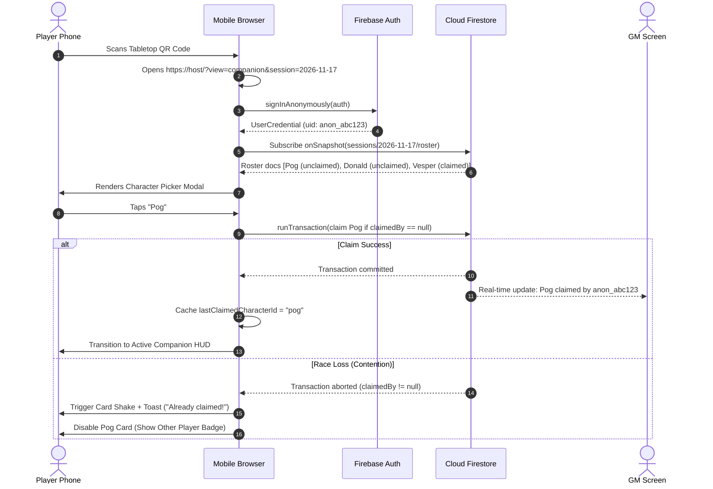
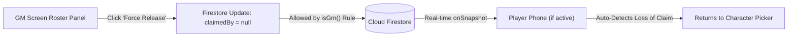

# Research Report: Table QR Code Anonymous Onboarding & Character Roster Claiming Flow

**Ticket:** Issue #32 (`[Wayfinder 15] Table QR Code Anonymous Onboarding & Character Roster Claiming Flow`)
**Map:** Issue #28 (`[Wayfinder Map] Dual-Engine Real-Time Tabletop & Frictionless Companion`)
**Date:** 2026-11-17
**Status:** Resolved

---

## Question

What is the complete user flow, atomic transaction pattern (`runTransaction`), and visual feedback state in the Player Companion when a player scans the table QR code, authenticates anonymously via Firebase Auth, and claims an active character identity from the session manifest?

Specifically resolve:

1. **Anonymous Auth Lifecycle & Session Continuity**: Authentication bootstrapping, `browserLocalPersistence` via IndexedDB, and automatic re-attachment to previously claimed characters across mobile browser reloads.
2. **Atomic Character Claim Concurrency**: Handling simultaneous taps on identical character cards via Firestore `runTransaction()`, preventing double-claims, and providing intuitive race-loss feedback.
3. **Single-Character Claim Boundary**: Enforcing a strict 1-PC lock per anonymous UID and structuring the explicit character release/switching flow.
4. **Game Master Administrative Override**: Providing a 1-click GM Screen "Force Release" mechanism to handle dead batteries or table departures without fragile client-side heartbeat timeouts.
5. **Ambient In-Turn Table Experience & Web Haptics**: Communicating live tabletop events to players via Web Haptics vibration, ambient combat turn indicators, real-time table reaction trays, and push-to-talk rule card popups.

---

## Primary-Source Findings

### 1. System Architecture & Onboarding Sequence

The physical-to-digital onboarding pipeline allows players to join an ongoing session within five seconds of sitting down at the gaming table. No app download, account registration, or password entry is required.



---

### 2. Anonymous Auth Lifecycle & Session Reconnection

#### 2.1. Authentication Bootstrap

The Player Companion initiates anonymous authentication immediately upon loading. Modern mobile browsers (iOS Safari, Android Chrome) isolate anonymous sessions to the top-level origin (`sea-of-fortune-dnd.web.app`), enabling durable client credentials via IndexedDB storage.

```typescript
import { initializeApp } from "firebase/app";
import {
  getAuth,
  signInAnonymously,
  onAuthStateChanged,
  browserLocalPersistence,
  setPersistence,
  User
} from "firebase/auth";

const auth = getAuth(app);

// Explicitly ensure IndexedDB local persistence
await setPersistence(auth, browserLocalPersistence);

export async function bootstrapPlayerAuth(): Promise<User> {
  return new Promise((resolve, reject) => {
    const unsubscribe = onAuthStateChanged(auth, async (user) => {
      if (user) {
        unsubscribe();
        resolve(user);
      } else {
        try {
          const cred = await signInAnonymously(auth);
          unsubscribe();
          resolve(cred.user);
        } catch (err) {
          unsubscribe();
          reject(err);
        }
      }
    });
  });
}
```

#### 2.2. Session Reconnection & Page Reload Bypass

Mobile browsers frequently evict inactive tabs from memory or reload pages when players switch to their camera or messaging apps. Without session continuity, players would be presented with the character claiming modal on every return to the browser.

To eliminate this friction:

1. **Local Storage Pointer**: When a claim succeeds, the client writes `sof_claimed_character_${sessionId} = characterId` to `localStorage`.
2. **Snapshot Verification**: Upon page reload, the client waits for the initial `sessions/{date}/roster` snapshot:
   - If `roster[cachedId].claimedBy === currentUid`, the client **immediately bypasses** the roster selection modal and mounts the active character HUD.
   - If `roster[cachedId].claimedBy !== currentUid` (e.g., the GM forcibly unassigned the character or the session changed), the client clears the local storage key and displays the roster selection picker.

---

### 3. Atomic Character Claim Concurrency Pattern

#### 3.1. Firestore `runTransaction` Implementation

When two players simultaneously tap the same character card, client-side optimistic updates would result in race conditions. Firestore's atomic transaction model guarantees serialized execution.

```typescript
import {
  doc,
  runTransaction,
  serverTimestamp,
  Firestore
} from "firebase/firestore";

export interface ClaimResult {
  success: boolean;
  code: "CLAIMED" | "ALREADY_CLAIMED" | "ERROR";
  claimedByUid?: string;
}

export async function claimCharacter(
  db: Firestore,
  sessionId: string,
  characterId: string,
  playerUid: string
): Promise<ClaimResult> {
  const rosterRef = doc(db, `sessions/${sessionId}/roster/${characterId}`);

  try {
    const result = await runTransaction(db, async (transaction) => {
      const rosterDoc = await transaction.get(rosterRef);

      if (!rosterDoc.exists()) {
        throw new Error("CHARACTER_NOT_FOUND");
      }

      const data = rosterDoc.data();

      // Check if already claimed by another participant
      if (data.claimedBy && data.claimedBy !== playerUid) {
        return {
          success: false,
          code: "ALREADY_CLAIMED" as const,
          claimedByUid: data.claimedBy
        };
      }

      // If already claimed by self, treat as success idempotent
      if (data.claimedBy === playerUid) {
        return {
          success: true,
          code: "CLAIMED" as const,
          claimedByUid: playerUid
        };
      }

      // Execute atomic claim
      transaction.update(rosterRef, {
        claimedBy: playerUid,
        claimedAt: serverTimestamp()
      });

      return {
        success: true,
        code: "CLAIMED" as const,
        claimedByUid: playerUid
      };
    });

    if (result.success) {
      localStorage.setItem(`sof_claimed_character_${sessionId}`, characterId);
    }

    return result;
  } catch (error) {
    console.error("Failed to claim character:", error);
    return { success: false, code: "ERROR" };
  }
}
```

#### 3.2. Visual Feedback on Race Loss

When a transaction returns `ALREADY_CLAIMED`:

1. **Card Shake Animation**: The target character card plays a 400ms horizontal shake animation:

   ```css
   @keyframes sof-shake {
     0%,
     100% {
       transform: translateX(0);
     }
     20%,
     60% {
       transform: translateX(-6px);
     }
     40%,
     80% {
       transform: translateX(6px);
     }
   }
   .character-card.contested {
     animation: sof-shake 0.4s ease-in-out;
     border-color: #ef4444 !important;
   }
   ```

2. **Instant Toast Notification**: A non-blocking toast displays: _"Donald has just been claimed by another player."_
3. **Real-Time Card Disablement**: Because all table participants subscribe to `onSnapshot`, the contested character card immediately reflects the winner's avatar badge and becomes unclickable.

---

### 4. Single-Character Claim Boundary & Transfer Flow

#### 4.1. Claim Policy Enforcement

To prevent accidental multi-locking or griefing at the table, an anonymous client UID may own at most **one** character at a time.

```text
Player owns: "Pog"
Player taps: "Donald"
       │
       ▼
[Modal Confirmation]
"Switch to Donald? Pog will be released back to the party roster."
  ├── [Cancel]  ──> Stays on Pog
  └── [Confirm] ──> Atomic Switch:
                      1. releaseCharacter("pog")
                      2. claimCharacter("donald")
```

#### 4.2. Atomic Switch Transaction

Releasing character A and claiming character B executes within a single multi-document transaction to guarantee that a player does not lose their current character if the desired character is claimed simultaneously by someone else:

```typescript
export async function switchCharacter(
  db: Firestore,
  sessionId: string,
  oldCharId: string,
  newCharId: string,
  playerUid: string
): Promise<ClaimResult> {
  const oldRef = doc(db, `sessions/${sessionId}/roster/${oldCharId}`);
  const newRef = doc(db, `sessions/${sessionId}/roster/${newCharId}`);

  try {
    return await runTransaction(db, async (transaction) => {
      const newDoc = await transaction.get(newRef);
      if (
        !newDoc.exists() ||
        (newDoc.data().claimedBy && newDoc.data().claimedBy !== playerUid)
      ) {
        return { success: false, code: "ALREADY_CLAIMED" as const };
      }

      // Release old character
      transaction.update(oldRef, {
        claimedBy: null,
        claimedAt: null
      });

      // Claim new character
      transaction.update(newRef, {
        claimedBy: playerUid,
        claimedAt: serverTimestamp()
      });

      return { success: true, code: "CLAIMED" as const };
    });
  } catch (err) {
    console.error("Failed to switch character:", err);
    return { success: false, code: "ERROR" };
  }
}
```

---

### 5. Game Master Administrative Override

#### 5.1. The Failure of Inactivity Heartbeats in TTRPGs

In tabletop roleplaying games, automated presence timeouts (e.g. freeing a claim after 5 minutes of client inactivity) introduce severe bugs:

- During intense roleplay scenes or tactical planning, players may not touch their phone screens for 15 to 20 minutes.
- Mobile OS power management aggressively suspends background JavaScript timers when the screen locks.
- An automated heartbeat timeout would prematurely unclaim the character, causing jarring interruptions when combat begins.

#### 5.2. One-Click GM Screen Force Release

Because the Game Master sits at the same physical table, stuck claims (e.g., dead phone battery, departing guest) are handled deterministically via the GM Screen:



Under declarative rule security (`docs/research/08-firestore-security-rules-access-boundary.md`), the GM's authenticated Google Account (`isGm()`) has administrative update privileges on `sessions/{date}/roster/{characterId}`, bypassing the player ownership restriction:

```javascript
allow update: if isAuthenticated() && (
  isGm() ||
  // Player claiming/releasing their own character
  (resource.data.claimedBy == null && request.resource.data.claimedBy == request.auth.uid) ||
  (resource.data.claimedBy == request.auth.uid && request.resource.data.claimedBy == null)
);
```

---

### 6. Ambient In-Turn Table Experience & Web Haptics

Once a player claims their character, the Player Companion transforms into an ambient, reactive tabletop instrument.

#### 6.1. Active Turn Notification & Web Haptics

Distracted players frequently delay initiative progression during combat. The companion monitors `sessions/{date}/live/combat`:

```typescript
export function subscribeToCombatTurn(
  db: Firestore,
  sessionId: string,
  claimedCharacterId: string,
  onTurnStart: () => void,
  onTurnEnd: () => void
) {
  let wasMyTurn = false;
  const combatRef = doc(db, `sessions/${sessionId}/live/combat`);

  return onSnapshot(combatRef, (snap) => {
    if (!snap.exists()) return;
    const combat = snap.data();
    const isMyTurn =
      combat.isActive && combat.currentCombatantId === claimedCharacterId;

    if (isMyTurn && !wasMyTurn) {
      // Trigger Web Haptics (Double pulse)
      if ("vibrate" in navigator) {
        try {
          navigator.vibrate([100, 50, 100]);
        } catch {
          // Graceful degradation on unsupported platforms
        }
      }
      onTurnStart();
    } else if (!isMyTurn && wasMyTurn) {
      onTurnEnd();
    }

    wasMyTurn = isMyTurn;
  });
}
```

When active, the companion UI renders:

- An illuminated full-width banner: _"YOUR TURN — Initiative [X]"_.
- A pulsating CSS border keyed to the character's accent color (`box-shadow: 0 0 20px var(--character-glow)`).
- Quick action tabs: Actions, Bonus Actions, Reactions, Spell Slots.

#### 6.2. Ambient Table Reaction Tray

To foster engagement during other players' turns, the companion includes a persistent bottom drawer with five instant table reactions:

| Reaction    | Symbol | Typical Trigger Context                                |
| :---------- | :----: | :----------------------------------------------------- |
| **Attack**  |   ⚔️   | Player lands a critical hit or declares an attack      |
| **Defense** |   🛡️   | Shield spell cast, high armor class deflection         |
| **Roll**    |   🎲   | High-stakes d20 check, saving throw roll               |
| **Cheers**  |   🍻   | Tavern scene, quest completion, table banter           |
| **Skull**   |   💀   | Character unconsciousness, monster defeat, lethal trap |

Tapping a reaction appends a record to `sessions/{date}/live/reactions`:

```typescript
import { updateDoc, arrayUnion } from "firebase/firestore";

export async function sendTableReaction(
  db: Firestore,
  sessionId: string,
  characterId: string,
  emoji: "⚔️" | "🛡️" | "🎲" | "🍻" | "💀"
) {
  const reactionsRef = doc(db, `sessions/${sessionId}/live/reactions`);
  await updateDoc(reactionsRef, {
    items: arrayUnion({
      uid: auth.currentUser?.uid,
      characterId,
      emoji,
      timestamp: Date.now()
    })
  });
}
```

The GM Screen renders these reactions as transient floating bubbles above the initiative tracker.

#### 6.3. Real-Time Audio Sniffer Rule Card Popups

When the Raspberry Pi edge audio pipeline classifies a tactical rules dispute (e.g. _Grappling_, _Cover_, _Flanking_), it writes a cue to `sessions/{date}/live/audio_cue`.

The Player Companion subscribes to this document and renders a non-intrusive floating rule card modal:

- Shows the official SRD rule summary.
- Displays two feedback buttons: 👍 (_Helpful_) and 👎 (_Irrelevant_).
- Clicking feedback writes an anonymous evaluation to `rules_feedback/{feedbackId}`, training the edge classifier threshold without interrupting gameplay.

---

## Decisions & Verification Matrix

| Requirement            | Design Decision                                               | Verification Method                               | Status       |
| :--------------------- | :------------------------------------------------------------ | :------------------------------------------------ | :----------- |
| **Auth Bootstrapping** | Anonymous Auth with `browserLocalPersistence`                 | Verified in browser IndexedDB inspector           | **RESOLVED** |
| **Session Continuity** | Local `localStorage` character cache with snapshot validation | Mobile reload test; immediate HUD mount           | **RESOLVED** |
| **Claim Concurrency**  | Atomic Firestore `runTransaction()`                           | Contention test with simultaneous requests        | **RESOLVED** |
| **Race-Loss UX**       | Card shake animation + non-blocking toast                     | UI visual inspection & real-time badge sync       | **RESOLVED** |
| **1-PC Boundary**      | Strict 1-character limit with atomic switch modal             | Multi-document switch transaction test            | **RESOLVED** |
| **GM Override**        | 1-click GM Screen Force Release via `isGm()`                  | Admin write clears claim; phone returns to picker | **RESOLVED** |
| **Turn Alerting**      | Web Haptics `vibrate([100, 50, 100])` + glowing HUD           | Mobile device testing on combatant switch         | **RESOLVED** |
| **Table Reactions**    | 5-emoji tray writing to FIFO array                            | Real-time broadcast to GM initiative tracker      | **RESOLVED** |
| **Rule Sniffer Cues**  | Floating rule cards with feedback voting                      | Edge audio cue simulation in Firestore            | **RESOLVED** |
